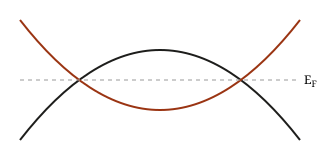

這篇是格式範例，`draft: true` 所以不會出現在網站上。

## 區塊

> [!def] 準粒子能量
> $$E_{n\vb{k}}^{\mathrm{QP}} = \epsilon_{n\vb{k}} + \expval{\psi_{n\vb{k}} | \Sigma(E^{\mathrm{QP}}_{n\vb{k}}) - V_{xc} | \psi_{n\vb{k}}}$$

> [!derive]- 從 Dyson 方程到一階修正
> 對角近似下 $G^{-1} = G_0^{-1} - (\Sigma - V_{xc})$，極點條件給出
> $$E = \epsilon + \Sigma(E) - V_{xc}.$$
> 在 $\epsilon$ 附近展開 $\Sigma$，得到 $Z = \left[1 - \partial_\omega \Sigma\right]^{-1}_{\omega=\epsilon}$。

> [!result]
> $E^{\mathrm{QP}} \approx \epsilon + Z\,\expval{\Sigma(\epsilon) - V_{xc}}$

> [!param] 收斂
> - `ecuteps` 和 `nbands` 要一起收斂
> - $\vb{q}$ 網格：$6\times6\times6$ 對 Si 已足夠

> [!warn]
> 不同程式的 $g_{mn\nu}(\vb{k},\vb{q})$ 差一個 $\sqrt{2\omega}$ 因子，比較前先查 convention。

> [!todo]
> 檢查 plasmon-pole 和 full-frequency 的差別

一般引用（沒有 `[!...]`）：

> 只是引用一段話。

## 數學

行內 $\Tr\rho$，獨立一行：

$$
\Sigma(\mathbf{r},\mathbf{r}';\omega) = \frac{i}{2\pi} \int \dd\omega'\, e^{i\omega'\eta}\, G(\mathbf{r},\mathbf{r}';\omega+\omega')\, W(\mathbf{r},\mathbf{r}';\omega')
$$

## 程式碼

```fortran
do ik = 1, nk
  eqp(:, ik) = edft(:, ik) + real(sigma(:, ik) - vxc(:, ik))
end do
```

## 圖片


